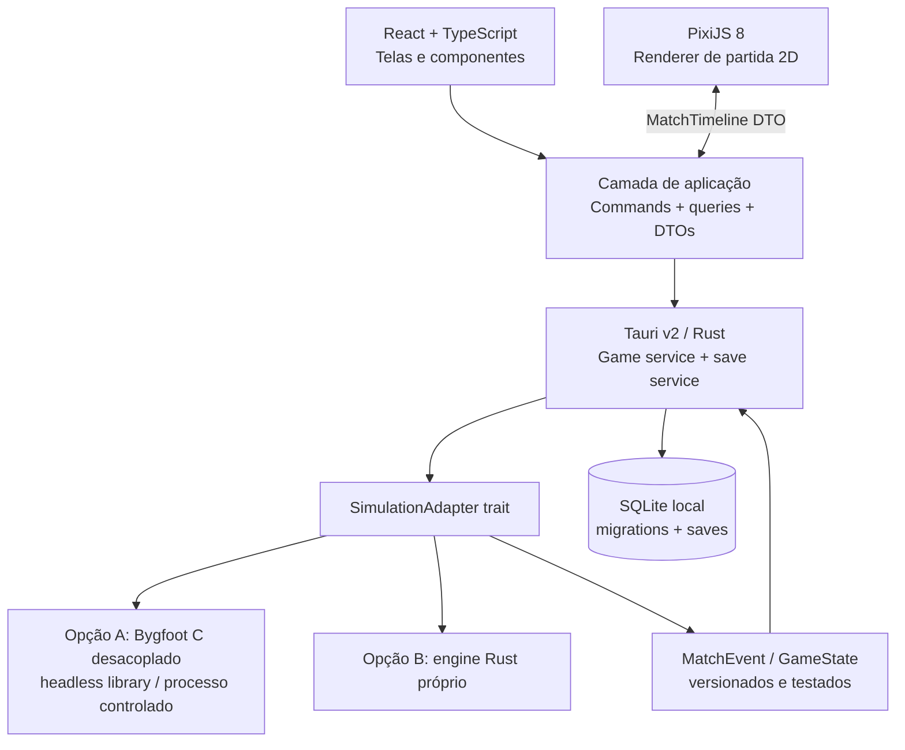

# Roadmap de modernização do Bygfoot — Football Manager 2D open source

> **Versão do plano:** 1.0 · **Data de referência:** 01/11/2026  
> **Estado:** proposta técnica; não é diagnóstico de código concluído  
> **Produto:** aplicativo desktop offline-first, gratuito, com interface moderna, gerenciamento de clubes e simulação de partidas em 2D.  
> **Equipe de referência:** 1 desenvolvedor sênior, 40 h/semana, com apoio de Claude Code.  
> **Nome do produto:** provisório; não usar marcas de terceiros como nome definitivo sem validação.

## 1. Resumo executivo

O objetivo é transformar a experiência do **Bygfoot** em um gerenciador de futebol acessível, visualmente sofisticado e com partidas 2D observáveis, **sem prometer 3D na primeira versão**. O projeto não deve começar com uma reescrita indiscriminada do motor de regras: primeiro será feito um *spike* técnico para verificar se a lógica em C pode operar sem GTK e expor comandos e eventos confiáveis.

**Decisão-base recomendada:**

- **UI desktop:** Tauri v2 + React + TypeScript + Vite + Tailwind CSS + componentes acessíveis (Radix/shadcn quando apropriado).
- **Campo 2D:** PixiJS 8, isolado do React por uma interface de apresentação de eventos.
- **Orquestração local:** Rust na camada Tauri (comandos, serviços, arquivos, integridade de dados).
- **Persistência:** SQLite, com migrations e esquema do projeto; adaptadores para importação de saves do Bygfoot 3.0 quando viável.
- **Simulação:** reutilizar ou adaptar o motor Bygfoot em C **apenas se o spike aprovar**; caso contrário, construir um motor mínimo próprio em Rust para o novo projeto.
- **Alternativa Godot:** manter documentada como opção, sem misturá-la ao MVP. Trocar PixiJS por Godot não é uma substituição direta no Tauri; exige arquitetura de aplicação diferente.

**Por que essa escolha:** a aplicação é majoritariamente tabelas, formulários, estatísticas e dashboards; React entrega essa experiência mais rapidamente para uma equipe já familiarizada com TypeScript. A renderização do campo pode ficar especializada no PixiJS. Godot continua sendo excelente quando a prioridade passa a ser a experiência de jogo, física e 3D.

### 1.1. Marco de entrega e estimativas

| Resultado | Prazo relativo | Escopo |
|---|---:|---|
| Spike técnico e protótipo de integração | Semanas 1–3 | Provar modelo de dados, comando de simulação e viabilidade do motor |
| Protótipo vertical utilizável | Semanas 4–8 | Abrir clube, elenco, navegar e visualizar uma partida de exemplo |
| Alpha jogável | Semanas 9–16 | Loop de gestão, tabela, calendário, jogo 2D e salvamento |
| MVP público | Semanas 17–24 | Uma temporada completa, teste, estabilidade e empacotamento |
| Versão 1.0 expandida | 12–18 meses totais | IA tática mais rica, evolução de jogador, ligas extras, editor e polimento |

**Estimativa base para MVP:** 18–26 semanas (720–1.040 horas em tempo integral), desde que a reutilização do motor seja viável e não se exija uma simulação espacial física completa. Reservar **20–30%** da capacidade para bugs, integração e refatoração. Se o motor C tiver acoplamento profundo à UI ou o simulador espacial for exigido no MVP, replanejar para **6–9 meses ou mais**.

| Capacidade | Prazo de referência para MVP |
|---|---|
| 40 h/semana | 4–6 meses, sujeito ao spike |
| 20 h/semana | 8–12 meses |
| 10 h/semana | 16–24 meses |

Os prazos são estimativas de planejamento, não compromissos nem previsões derivadas de análise profunda do repositório.

## 2. Contexto verificado do projeto original

- **Bygfoot 3.0.0:** anunciado oficialmente em 17/02/2026. A página oficial cita novo formato de save SQLite e simulações mais rápidas.
- **Código-fonte:** GitLab `bygfoot/bygfoot`; aplicativo histórico implementado majoritariamente em C. Verificado em 2026-11-01 no clone de estudo: a tag `3.0.0` (`767acfa`) é anterior ao `HEAD` (`9b7b006`), que já inclui o port de GTK 2 para GTK 3 e a migração do build para CMake. A Fase 0 decide qual versão fixar.
- **Licença:** o pacote Fedora da versão 3.0.0 identifica **GPL-2.0-only**; verificar `COPYING`, avisos e arquivos individualmente no checkout que será usado.
- **Projeto de referência alternativo:** OpenFootManager usa Rust + React + Tauri + SQLite, com licença GPLv3. Serve como referência de arquitetura/UX; **não copiar código entre projetos sem análise de licenças e proveniência**.
- **Limitação conhecida:** a existência do save em SQLite **não prova** que o motor C já exponha APIs headless, eventos espaciais ou esquema estável para terceiros. Essas características exigem inspeção e protótipo.

### 2.1. Decisão de origem do código (obrigatória antes da implementação)

**Caminho A — Fork/adaptação GPL do Bygfoot (caminho principal, confirmado pela pessoa responsável em 2026-11-01; vale se o gate G1 aprovar):** manter o código do upstream em `upstream/` sem edição, com remendos mínimos e listados em `patches/MANIFEST.md`, para que o fork continue recebendo atualizações. Extrair a lógica para uma biblioteca C ou processo de simulação sem GTK, preservar avisos e obrigações GPL, distribuir fontes e componentes conforme licença aplicável. A ligação com frontend/bundling devem ser revisados juridicamente; usar IPC **não garante automaticamente** independência de licenças.

**Caminho B — Motor original em Rust:** construir regras de domínio e simulação próprias, com especificação funcional, testes e dados próprios, sem copiar código protegido do Bygfoot. **Importação de dados** e reutilização de ideias/formatos precisam de revisão de compatibilidade e direitos.

**Critério de escolha na semana 3:** integração real demonstrada, custo de manutenção, licença, estabilidade e possibilidade de obter eventos. O projeto **não** deve acumular os dois motores completos em paralelo.

## 3. Visão, público e loop central

### 3.1. Promessa de experiência

> Dirigir um clube fictício do início ao fim de uma temporada, tomar decisões com impacto visível, assistir a uma partida tática 2D compreensível e entender por que venceu ou perdeu.

### 3.2. Pilares de design

1. **Profundidade sem burocracia:** dados suficientes para decisões, com hierarquia visual clara.
2. **Partida explicável:** ações em campo, placar e estatísticas têm uma única origem lógica.
3. **Offline-first, leve e rápido:** sem dependência de conta ou backend na nuvem.
4. **Modificável e transparente:** saves locais, dados fictícios e configurações editáveis na medida do possível.
5. **Progresso confiável:** temporada pode ser concluída, retomada e reproduzida sem corrupção de dados.

### 3.3. Loop do jogador

`Caixa de entrada → avaliar elenco → ajustar escalação/tática → mercado/treino → avançar dia → acompanhar jogo 2D → analisar resultado → corrigir estratégia → repetir`.

### 3.4. Não objetivos do MVP

- Partidas 3D; física de colisão realista; captura de movimento.
- Multijogador online, sincronização cloud, serviços pagos e mobile.
- Licenças oficiais de clubes, escudos e atletas reais; scraping de bases comerciais.
- Todos os países/ligas do mundo, categorias de base completas, editor avançado de modding.
- Motor baseado em LLM que decide cada passe: custo, imprevisibilidade e pouca reprodutibilidade.
- Paridade de recursos com Football Manager comercial.

## 4. Escopo priorizado (MoSCoW)

| Área | Must — MVP | Should — pós-MVP | Could — V1+ |
|---|---|---|---|
| Clubes/ligas | 1 liga fictícia de 12 clubes | múltiplas divisões | editor de competições |
| Jogadores | atributos, posições, contratos | lesões e moral avançadas | personalidades e relações |
| Gestão | elenco, seleção, transferências básicas, finanças mínimas | scouting e funcionários | categorias de base |
| Táticas | formação, escalação, estilo de jogo, substituições | instruções por atleta | treino tático sofisticado |
| Partidas | simulação de resultado, eventos coerentes e replay 2D | posicionamento por tick | física/IA espacial complexa |
| Temporada | tabela, calendário, classificação, campeão | copas, acesso/rebaixamento | continentes e seleções |
| Save | criar, carregar, backup e versão de esquema | migração de saves legados | compartilhamento de mods |
| Interface | desktop acessível, dark/light, PT-BR | inglês, personalização maior | controller/Steam Deck |
| Distribuição | Windows, Linux e macOS | Assinatura e notarização automatizadas | Steam/itch.io |

**Definição de MVP:** é possível começar uma carreira com 1 clube, jogar **22 rodadas** de uma liga de 12 clubes em turno e returno, alterar escalações e táticas, contratar/vender sob regras delimitadas, salvar/carregar em qualquer rodada e terminar a temporada com uma classificação correta.

## 5. Arquitetura técnica



### 5.1. Fronteiras do projeto

| Camada | Responsabilidade | Não deve fazer |
|---|---|---|
| `ui` | estado de navegação, formulários, tabelas e gráficos | decidir placares ou alterar save diretamente |
| `match-2d` | interpolar posições, renderizar campo, animações, replay | inventar gols, passes ou estatísticas independentes |
| `application` | orquestrar comandos e validar fluxos | acoplar em APIs GTK |
| `simulation-adapter` | unificar engine A/B, validar eventos | escrever DOM ou manipular PixiJS |
| `domain` | tipos de negócio, regras, invariantes | importar lógica visual |
| `persistence` | DB, schema, migrations, integridade, backup | executar regra tática não versionada |

### 5.2. Contratos essenciais

- `StartCareer(settings) -> CareerId`
- `GetClubOverview(careerId) -> ClubOverview`
- `ListSquad(clubId) -> Player[]`
- `SaveLineup(careerId, tactic) -> ValidationResult`
- `AdvanceDay(careerId) -> CalendarUpdate`
- `SimulateMatch(careerId, fixtureId, seed) -> MatchResult + MatchTimeline`
- `SaveCareer(careerId) -> SaveMetadata`
- `LoadCareer(saveId) -> CareerSnapshot`

**Invariantes:** mesma seed + mesmo estado inicial + mesma versão de regras => mesmo resultado; nenhum jogador participa de dois times no mesmo jogo; gols por evento = placar; partidas concluídas não mudam sem comando; transferências preservam orçamento e vínculo; todo save tem versão de esquema e backup válido.

### 5.3. Exemplo de evento de partida

Exemplo **proposto**, não uma API existente do Bygfoot:

```json
{
  "schemaVersion": 1,
  "matchId": "match-001",
  "seed": 431199,
  "tickMs": 200,
  "timeSeconds": 3260,
  "eventType": "pass",
  "teamId": "club-03",
  "actorPlayerId": "player-022",
  "targetPlayerId": "player-026",
  "from": { "x": 34.2, "y": 31.1 },
  "to": { "x": 54.5, "y": 28.0 },
  "outcome": "completed"
}
```

**Convenção do campo:** coordenadas em metros, `x` de 0 a 105 e `y` de 0 a 68; espelhar times somente no renderer. Se o motor fornecer apenas minutos/eventos sem coordenadas, marcar `from/to` como opcionais e aplicar regras de visualização **explicitamente aproximadas**.

### 5.4. Dados mínimos

- `career`, `season`, `competition`, `club`, `player`, `contract`, `transfer`, `fixture`, `standing`.
- `lineup`, `tactic`, `formation_slot`, `match`, `match_event`, `save_metadata`, `schema_version`.
- Dataset fictício inicial: **12 clubes × ~25 jogadores = ~300 atletas**, uma divisão, temporada de 22 rodadas.
- Saves de carreira versionados: não editar diretamente os arquivos do Bygfoot como estratégia de integração permanente. Usar importador separado e backup antes de migrar.

## 6. Motor de partidas: estratégia incremental

### Nível 0 — Simulação textual real (pré-requisito)

O engine decide placar, cartões, faltas, substituições, chances, finalizações, posse e resultados. Cada evento altera estado e tem timestamp. Estatísticas derivam dos eventos, não de contadores desconectados.

### Nível 1 — Visualização 2D dos eventos (MVP)

- Campo visto de cima com 22 marcadores e bola, cores originais dos times fictícios.
- Animações por interpolação entre eventos; câmera fixa; velocidade `1x`, `2x`, `4x`, pausa e replay.
- Indicadores de posse, trajetória da bola, destaque do jogador, caixa de comentários e minimapa tático quando pertinente.
- Para um engine que não calcula trajetórias exatas, o replay será **uma representação estilizada** da sequência causal, não física real.
- **Camada de coreografia (decidida em 2026-11-01):** o `LiveGameUnit` do Bygfoot traz posse, área (defesa, meio, ataque), minuto, placar e evento, sem coordenadas. Para a fluidez de um replay a 60 fps, uma camada de coreografia (apenas visual, com seed fixa) inventa passes entre jogadores, corridas do bloco, mergulho do goleiro e comemoração, sempre terminando no resultado que o motor mandou. Ela nunca decide placar, autor do gol nem classificação. Simulação espacial real continua sendo o Nível 2.
- O resultado final e o placar precisam existir independentemente de PixiJS.

### Nível 2 — Simulação espacial (depois do MVP)

- Estado posicional contínuo para 22 atletas/bola, decisões por ciclo temporal determinístico.
- FSM/Utility AI para posicionar, pressionar, desmarcar, passar e finalizar.
- Estratégia tática alterando posicionamento/decisão, não apenas multiplicadores de gols.
- IA e física devem ter testes de invariantes, seeds de regressão, custo computacional e equilíbrio.

### Nível 3 — 3D (fora do MVP)

Só após maturidade da simulação espacial; avaliar arquitetura Godot ou outro renderer compatível. Não assumir que `PixiJS -> Godot` é troca de uma biblioteca.

## 7. Design visual, UX e acessibilidade

### 7.1. Direção de arte proposta (inicial; sujeita a prototipagem)

- **Identidade:** central de análise de futebol / mesa de treinador, e não visual genérico de painel SaaS.
- **Tema:** fundo escuro grafite/azul, superfícies discretas, acento verde gramado para ações e comparação de desempenho; versão clara equivalente.
- **Tipografia:** legível em tabelas densas, numerais tabulares para valores; não depender apenas de cor para estados.
- **Motion:** discreto nos painéis, mais evidente apenas nas transições do campo; respeitar `prefers-reduced-motion`.
- **Tokens:** cores, espaçamento, elevação, estados, tipografia e densidade documentados em `design-system/MASTER.md`.

### 7.2. Telas do MVP

1. **Início de carreira** — escolha do clube, perfil do treinador, dificuldade e regras.
2. **Dashboard** — próximo jogo, finanças, moral, últimos resultados, notícias e tarefas.
3. **Elenco** — tabela com filtros, posições, atributos, contratos e status; detalhes do atleta.
4. **Táticas** — campo 2D arrastável, banco, formação, instruções, validações.
5. **Mercado** — buscar, filtrar, propor e concluir operações básicas.
6. **Calendário/classificação** — tabela de pontos, resultados e próximas rodadas.
7. **Dia de jogo** — escalação, placar, relógio, eventos, estatísticas e campo PixiJS.
8. **Pós-jogo** — resumo, eventos, métricas e consequências.
9. **Finanças** — receitas/despesas simples, folha salarial e orçamento disponível.
10. **Save/configurações** — salvar, carregar, backups, idioma e acessibilidade.

### 7.3. Critérios de interface

- Teclado utilizável nos fluxos principais; foco visível; rótulos e textos de erro concretos.
- Alvo **WCAG 2.2 AA** para componentes React pertinentes; testes automáticos + auditoria manual.
- Testar 1366×768, 1440×900, 1920×1080, ultrawide e escalonamento 125–150%.
- Estados de loading, vazio, erro, confirmação e autosave claramente definidos.
- Navegação não deve deixar o jogador perder uma escalação sem aviso.
- Componentes testados com dados realistas (~300 jogadores e temporadas com partidas concluídas).

## 8. Roadmap em 12 sprints (2 semanas cada)

**Ajuste de ordem (2026-11-01):** a partida em tempo real (Sprint 07, "Reprodução 2D v1", com a camada de coreografia) passa a vir **antes** das telas de gestão (Sprints 03 e 04). Fases do roadmap visual: 0 spike (sem 1–2), 1 núcleo headless nos 3 sistemas (3–5), 2 app Tauri e primeira partida (6–8), 3 partida ao vivo (9–12), 4 telas de gestão (13–17), 5 temporada completa (18–21), 6 acabamento e lançamento (22–26), 7 simulação espacial opcional (depois do v0.1). Onde esta lista divergir dos sprints abaixo, vale a lista.

**Regra:** cada sprint precisa entregar software demonstrável ou risco técnico resolvido; tarefas de simulação e integração têm prioridade sobre refinamento cosmético. A lista abaixo é um backlog inicial, não uma garantia de esforço exato.

### Sprint 01 — Semanas 1–2 | Descoberta, licença e diagnóstico do C

- [ ] `BF-001` Clonar o upstream do Bygfoot **sem modificar** e registrar commit/tag do estudo.
- [ ] `BF-002` Mapear `src/`, save SQLite 3.0, dependências GTK, funções de calendário e match.
- [ ] `BF-003` Executar build original em ambiente isolado; coletar logs, testes e amostras de saves fictícios.
- [ ] `BF-004` Elaborar mapa das chamadas do motor e lista de funções que dependem de UI.
- [ ] `BF-005` Registrar análise inicial de GPL, assets, marcas e modelo de distribuição.
- [ ] `BF-006` Criar um GDD enxuto, personas, pilares, fluxos e wireframes das 4 telas essenciais.

**Entrega:** `docs/REVERSE_ENGINEERING.md`, `docs/GDD.md`, `docs/LEGAL_REVIEW.md`, benchmark do Bygfoot original.  
**Gate:** conhecer o limite de separação UI/core e os dados disponíveis; sem esse conhecimento, não estimar integração como concluída.

### Sprint 02 — Semanas 3–4 | Prova de integração e decisão arquitetural

> **Estado em 2026-11-02 (Fase 1 na branch `fase-1-nucleo`):** G1 cumprido nos pontos testados — simulação headless repetível nos 3 sistemas; igualdade entre sistemas só com 3 remendos (ADR-002); contrato `MatchTimeline v1` testado; infraestrutura de remendos e de sincronização com o upstream criada. Pendentes: save sem versão, lances ao vivo (geração lance a lance), partida avulsa por ids, revisão jurídica. Veja `docs/adr/ADR-001` e `ADR-002`.

- [ ] `BF-010` Prototipar uma chamada headless ao simulador: `simulate_fixture` com entrada e saída estruturadas.
- [ ] `BF-011` Se integração em C falhar, criar PoC Rust com 1 partida determinística + eventos.
- [ ] `BF-012` Definir contrato versionado `SimulationAdapter` e persistência com migrations.
- [ ] `BF-013` Criar esqueleto Tauri/React/TS/PixiJS com CI, lint e testes.
- [ ] `BF-014` Medir complexidade/custo das alternativas A e B; publicar `ADR-001` e `ADR-002`.
- [ ] `BF-015` Montar o primeiro tema e uma tela navegável de clube com dados mockados.

**Entrega:** `hello-match` de ponta a ponta e decisão **seguir/corrigir/pivotar**.  
**Gate crítico:** um backend consegue simular e devolver resultado sem depender de janela GTK. Se não, construir engine mínimo Rust e reestimar.

### Sprint 03 — Semanas 5–6 | Modelo de carreira e UX base

> **Estado em 2026-11-03 (Fase 3 na branch `fase-3-ao-vivo`):** reprodução 2D da timeline em PixiJS (relógio, coreografia determinística, campo visual B, camada de análise C opcional), com testes e CI; coreografia é aproximação visual, desempenho medido só no Chrome/macOS (ADR-004).

> **Estado em 2026-11-03 (Fase 2 na branch `fase-2-app`):** casca Tauri 2 + React/TS, crate `engine-adapter` (motor como processo separado, contrato `MatchTimeline v1` validado) e tela "Primeira partida" com CI verde nos 3 sistemas (ADR-003). Falta empacotar o motor (Fase 6) e os lances ao vivo (Fase 3).

- [ ] `BF-020` Entidades: clube, atleta, campeonato, calendário, contrato e carreira.
- [ ] `BF-021` Criar dataset fictício validado com 12 clubes e 300 jogadores.
- [ ] `BF-022` Implementar fluxo criar carreira → abrir dashboard → listar elenco.
- [ ] `BF-023` Design tokens, componentes-base, sidebar, navegação e layout responsivo.
- [ ] `BF-024` Testes unitários de regras e contratos do adapter.

**Entrega:** carreira nova navegável sem dados mockados nas telas principais.

### Sprint 04 — Semanas 7–8 | Gestão de elenco e primeiro corte vertical

- [ ] `BF-030` Elenco com filtros, atributos, ficha individual e estado de contrato.
- [ ] `BF-031` Montagem de escalação com 11 titulares, posições e banco.
- [ ] `BF-032` Calendário com próximos jogos e classificação inicial.
- [ ] `BF-033` Rodar uma partida e exibir placar + sequência textual coerente.
- [ ] `BF-034` Campo PixiJS renderizando replay mínimo de 1 evento estruturado.

**Entrega:** **vertical slice** jogável (ainda sem temporada finalizável).

### Sprint 05 — Semanas 9–10 | Progressão de temporada

- [ ] `BF-040` Avanço de dia/rodada sem inconsistência temporal.
- [ ] `BF-041` Tabela e confrontos corretos para 12 clubes, turno e returno.
- [ ] `BF-042` Persistir e recuperar estado completo com versão de schema.
- [ ] `BF-043` Criar backup automático, verificação de integridade e arquivo de exemplo.
- [ ] `BF-044` Garantir classificação reproduzível por jogos e critérios de desempate.

**Entrega:** jogo avançando múltiplas rodadas e retomando sessão.

### Sprint 06 — Semanas 11–12 | Gestão financeira e transferências

- [ ] `BF-050` Folha salarial e orçamento simplificados, com invariantes de caixa.
- [ ] `BF-051` Transferência básica: proposta, aceite/recusa, atualização de contrato e elenco.
- [ ] `BF-052` Tela de mercado com filtros e estados de negociação.
- [ ] `BF-053` Notificações no dashboard e histórico de transações.
- [ ] `BF-054` Testes de concorrência de comando e integridade do save.

**Entrega:** decisões fora de campo com consequências persistentes.

### Sprint 07 — Semanas 13–14 | Reprodução 2D v1

- [ ] `BF-060` Campo e coordenadas normalizadas para 105×68 m.
- [ ] `BF-061` Jogadores e bola animados com interpolação, cores e legendas acessíveis.
- [ ] `BF-062` Eventos: passe, chute, gol, falta e substituição.
- [ ] `BF-063` Controles 1×/2×/4×, pausa, saltar para próximo lance e replay.
- [ ] `BF-064` Separar `simulation time` de `render time`; renderer nunca altera resultado.

**Entrega:** replay 2D que transmite a partida com consistência.

### Sprint 08 — Semanas 15–16 | Táticas, métricas e alpha

- [ ] `BF-070` Formações arrastáveis e regras de posição.
- [ ] `BF-071` Instruções básicas (mentalidade, pressão, ritmo), com efeito **medido** na simulação.
- [ ] `BF-072` Tela pós-jogo com posse, chutes, cartões e eventos derivados da timeline.
- [ ] `BF-073` Coletar seeds de regressão para táticas e perfis de equipe.
- [ ] `BF-074` Teste de usabilidade com 3–5 sessões observadas (sem declarar significância estatística).

**Entrega:** alpha jogável; primeira rodada com tática e replay.

### Sprint 09 — Semanas 17–18 | Temporada completa

- [ ] `BF-080` Garantir todas as 22 rodadas e campeão correto.
- [ ] `BF-081` Processar notícias, lesões simples e desgaste **somente se** não bloquear estabilidade.
- [ ] `BF-082` Fluxos de fim de temporada, registro histórico e nova temporada (simplificado).
- [ ] `BF-083` Carregar save de qualquer rodada, inclusive após fechar e reiniciar o aplicativo.
- [ ] `BF-084` Teste automatizado de 100+ temporadas por seeds distintas e validação de invariantes.

**Entrega:** temporada completa de ponta a ponta.

### Sprint 10 — Semanas 19–20 | Qualidade e performance

- [ ] `BF-090` Profiling CPU/RAM do motor e GPU do PixiJS.
- [ ] `BF-091` Testes E2E de iniciar carreira, escalar, simular, salvar, carregar e completar temporada.
- [ ] `BF-092` Revisão WCAG, teclado, contraste, reduced motion e estados de erro.
- [ ] `BF-093` Testar corrupção intencional de save, restauração de backup e migrations.
- [ ] `BF-094` Corrigir bugs P0/P1 e congelar schema do release candidate.

**Entrega:** release candidate técnico com benchmark comparativo.

### Sprint 11 — Semanas 21–22 | Distribuição e playtest

- [ ] `BF-100` Builds assináveis/instaláveis para Windows, Linux e macOS, com inventário de dependências.
- [ ] `BF-101` Packaging de engine C e assets, quando usados, conforme obrigações de distribuição.
- [ ] `BF-102` Geração de changelog, terceiros, licenças, instruções de instalação e logs seguros.
- [ ] `BF-103` Teste de instalação limpa em máquina sem ferramentas de desenvolvedor.
- [ ] `BF-104` Playtest externo, bugs priorizados por impacto na carreira e nos saves.

**Entrega:** beta empacotado, testável por terceiros.

### Sprint 12 — Semanas 23–24 | Estabilização e release MVP

- [ ] `BF-110` Corrigir bugs bloqueadores; auditar questões legais/atribuição.
- [ ] `BF-111` Confirmar campanha completa com save/load e táticas.
- [ ] `BF-112` Validar build limpa no Windows/Linux/macOS, sem privilégios desnecessários.
- [ ] `BF-113` Publicar README, imagens reais do aplicativo e roadmap pós-MVP.
- [ ] `BF-114` Tag e release `v0.1.0` (ou versão escolhida após auditoria).

**Entrega:** primeira versão jogável publicável; expansão posterior depende de feedback real.

## 9. Caminho crítico e critérios de saída

### 9.1. Dependências que não podem inverter

1. Verificar licença e acoplamento de C/GTK.
2. Escolher motor headless e contrato de `SimulationAdapter`.
3. Criar um jogo determinístico e eventos validados.
4. Salvar/retomar estado do jogo.
5. Renderizar os eventos já definidos pelo motor.
6. Expandir o loop de gestão e a temporada.
7. Otimizar e empacotar.

### 9.2. Três gates que podem mudar o plano

| Gate | Quando | Evidência | Se falhar |
|---|---|---|---|
| **G1: engine** | Fim da semana 4 | jogo simulado de forma headless, dados versionados | usar engine Rust mínimo; reestimar |
| **G2: vertical slice** | Fim da semana 8 | carreira → escalação → jogo → visualização | remover features secundárias |
| **G3: temporada** | Fim da semana 18 | 22 rodadas, save/load, classificação correta | bloquear polimento visual até estabilizar |

## 10. Riscos, hipóteses e mitigação

| Risco | Probabilidade/impacto | Plano |
|---|---|---|
| Motor C acoplado a GTK e estado global | Alto/alto | spike, documentação das dependências, pivot Rust |
| SQLite legada não expõe todos os dados necessários | Médio/alto | adaptar importador e usar schema próprio |
| Resultados sem localização de bola/jogadores | Alto/médio | replay estilizado com eventos; não declarar simulação espacial |
| Incompatibilidade/distribuição de licenças | Médio/alto | auditoria por arquivo e arquitetura; não combinar código incompatível |
| Balanceamento tático fraco | Alto/médio | seeds fixas, simulações em lote e análise de distribuições |
| Escopo inflado por features de Football Manager | Alto/alto | MoSCoW, critérios de MVP e cut-list por sprint |
| Dependência de skills/scripts não auditados | Médio/alto | revisar `SKILL.md`, hooks, comandos, origem e permissões |
| Problemas gráficos de WebView/Tauri no Linux | Médio/médio | builds e smoke tests em Linux desde o sprint 2 |
| Uso não autorizado de escudos/nomes/atletas | Médio/alto | dados e identidades fictícias no MVP |

**Regras de corte para proteger o release:** se houver atraso, remover scouting, lesões complexas, novas ligas, efeitos de partículas e editor avançado antes de cortar a capacidade de finalizar temporada e salvar.

## 11. Estratégia de testes e medidas

### 11.1. Testes por camada

- **Rust/C:** testes unitários de regras e de integração com o adapter; ASan/UBSan no C quando possível; build sem GTK do core, se extraído.
- **Determinismo:** snapshots por seed, mesmo estado inicial e versão; comparar sequência de eventos e placar.
- **Domínio:** pontos/campos/classificação, orçamento não negativo quando regra exigir, jogadores únicos, contratos e calendário sem duplicações.
- **Banco:** migrations em sequência, backup, integridade, falhas de energia simuladas, save legado de amostra.
- **React:** componentes, formulários, filtros, atalhos e estados vazios, Vitest + Testing Library.
- **Fluxos E2E:** Playwright na UI web; execução Tauri desktop exige ferramenta/estratégia apropriada, não tratar um teste no navegador como equivalente ao app empacotado.
- **PixiJS:** captura de frames, checagem de eventos, coordenadas e performance sob replay longo.
- **Acessibilidade:** axe-core onde aplicável + navegação manual por teclado.
- **Experiência:** playtest de entendibilidade da partida, onboarding e decisões táticas.

### 11.2. Indicadores-alvo a validar com benchmark do sprint 2

- 60 FPS visual no replay 2D em hardware de referência **definido e registrado**.
- Interface de listas sem travamentos perceptíveis com ~300 jogadores.
- Save/load íntegro em 100% dos testes automatizados de temporada.
- Nenhuma divergência entre placar, timeline e classificação.
- Táticas alteram distribuição de resultados de modo detectável em simulações em lote.
- Não definir RAM, tempo de startup ou tempo de simulação arbitrários antes do benchmark inicial.

## 12. Skills reais para Claude Code — seleção pesquisada

**Como funcionam:** skills são diretórios com um `SKILL.md` e, opcionalmente, referências e scripts. No Claude Code, uma skill local ao projeto é detectada em `.claude/skills/<nome>/SKILL.md`. Plugins são instalados por comandos `/plugin` **dentro do Claude Code**; `npx skills ...` roda no **terminal**. Instalar não significa que a skill foi executada ou testada neste projeto.

### 12.1. Núcleo recomendado

| Prioridade | Repositório/skill | Utilidade no projeto | Confiança/observação |
|---|---|---|---|
| P0 | [Claude Game Design Suite](https://github.com/baxatron-git/claude-game-design-suite) | GDD, core loop, economia, balanceamento, escopo e playtests | Comunidade; 22 skills; conjunto relativamente novo, auditar |
| P0 | [Awesome Gamedev Agent Skills](https://github.com/gamedev-skills/awesome-gamedev-agent-skills) | PixiJS, game UI/UX, IA de jogos, saves, assets, prototipagem e performance | Comunidade; 77 skills com roteador |
| P0 | [UI/UX Pro Max](https://github.com/nextlevelbuilder/ui-ux-pro-max-skill) | Design system, paletas, tipografia e diretrizes por stack | Comunidade; CLI atual chama `ui-ux-pro-max-cli` |
| P0 | [Frontend Design](https://github.com/anthropics/claude-plugins-official/tree/main/plugins/frontend-design) | Interface React intencional e não genérica | Plugin oficial Anthropic |
| P0 | [Superpowers](https://github.com/obra/superpowers) | Planejamento, TDD, debugging, code review e verificação | Metodologia de engenharia; instalar só após inspecionar |
| P1 | [Vercel Agent Skills](https://github.com/vercel-labs/agent-skills) | `react-best-practices` e `web-design-guidelines` | Origem Vercel; úteis para desempenho/acessibilidade |
| P2 | [Design Motion Principles](https://github.com/kylezantos/design-motion-principles) | Microinterações e auditoria de animações | Comunidade; polimento, não lógica de simulação |
| P2 | [Taste Skill](https://github.com/Leonxlnx/taste-skill) | Revisão estética de dashboards React | Opcional; sobrepõe outras skills visuais |

#### Skills específicas do Game Design Suite

**Instalar somente as necessárias no início** (nomes reais dos diretórios):

- `game-vision-architect` — visão e público.
- `design-pillars-architect` — pilares e regras para cortes.
- `core-loop-designer` — ciclo de carreira e retenção pelo jogo, não por manipulação.
- `rules-formalizer` — regras de competição, contrato e estados.
- `economy-progression-designer` — mercado, orçamento e evolução.
- `game-balance-analyst` — detectar táticas dominantes e desbalanceamento.
- `prototype-scope-definer` — corte vertical e hipóteses do protótipo.
- `playtest-protocol-designer` — roteiro de testes com jogadores.
- `ui-ux-systems-designer` — experiência de gestão e carga cognitiva.
- `gdd-author` — documentação de design viva.
- `scope-feature-prioritizer` — trade-offs e prioridades.

**Por fase:** visão/core loop (sprints 1–2); rules/economy/balance (sprints 3–8); playtest e scope (sprints 8–12).

#### Skills específicas do Awesome Gamedev Agent Skills

**Para a escolha React/PixiJS:**

- `pixijs-rendering` — scene graph, sprites, animação e eventos PixiJS 8.
- `game-ui-ux` — menus, HUD, escalabilidade, navegação e estados.
- `game-ai` e `ai-behavior-trees-utility-ai` — somente quando houver IA espacial real.
- `save-systems` — integridade e evolução de saves.
- `create-game-assets` — pipeline de arte, sprite e UI consistente.
- `prototype-fast` — vertical slice pequeno.
- `performance-optimization` — profiling e orçamento de renderização.
- `game-feel` — feedback de ações e transições, com moderação.

**Se houver pivot para Godot:** usar `godot-gdscript`, `godot-nodes-scenes`, `godot-ui-control`, `godot-animation`, `godot-gdscript-headless-testing`, `godot-export`; não instalar guias de engines diferentes indiscriminadamente.

### 12.2. Instalação verificada: comandos e ordem

**Pré-requisitos:** Claude Code instalado/autenticado; Git; Node.js **22.20+** para `npx skills`; Python 3.x para scripts de pesquisa do UI/UX Pro Max. Trabalhar na raiz do repositório no terminal WSL/Linux/macOS. Inspecionar a origem antes de executar qualquer CLI de terceiro.

**Etapa A — instalar plugins oficiais no Claude Code (comandos dentro de `claude`):**

```text
/plugin install frontend-design@claude-plugins-official
/plugin install superpowers@claude-plugins-official
```

**Etapa B — instalar skills de engenharia de jogos (terminal):**

```bash
# Inspecionar catálogo antes de instalar:
npx skills add gamedev-skills/awesome-gamedev-agent-skills --list

# Instalação seletiva no projeto atual:
npx skills add gamedev-skills/awesome-gamedev-agent-skills --skill pixijs-rendering -a claude-code
npx skills add gamedev-skills/awesome-gamedev-agent-skills --skill game-ui-ux -a claude-code
npx skills add gamedev-skills/awesome-gamedev-agent-skills --skill save-systems -a claude-code
npx skills add gamedev-skills/awesome-gamedev-agent-skills --skill prototype-fast -a claude-code
npx skills add gamedev-skills/awesome-gamedev-agent-skills --skill create-game-assets -a claude-code
```

**Alternativa** ao passo B, para quem quer todo o catálogo e roteamento: dentro do Claude Code:

```text
/plugin marketplace add gamedev-skills/awesome-gamedev-agent-skills
/plugin install gamedev@awesome-gamedev-agent-skills
```

Não instalar **as duas formas simultaneamente** sem motivo; evitar duplicatas e instruções conflitantes. O autor do pacote declara que a instalação por `npx` da coleção completa exige Node.js 22.20+.

**Etapa C — instalar UI/UX Pro Max (terminal):**

```bash
npx ui-ux-pro-max-cli init --ai claude
```

O pacote atual é **`ui-ux-pro-max-cli`**, não o antigo `uipro-cli`. A instalação também pode ser feita pelo marketplace do próprio projeto:

```text
/plugin marketplace add nextlevelbuilder/ui-ux-pro-max-skill
/plugin install ui-ux-pro-max@ui-ux-pro-max-skill
```

Escolher **uma** das duas formas.

**Etapa D — skills de UI e desempenho adicionais (terminal):**

```bash
npx skills add vercel-labs/agent-skills --skill vercel-react-best-practices -a claude-code
npx skills add vercel-labs/agent-skills --skill web-design-guidelines -a claude-code
```

**Etapa E — Game Design Suite (instalação seletiva após leitura do código):**

```bash
git clone --depth 1 https://github.com/baxatron-git/claude-game-design-suite.git /tmp/claude-game-design-suite

# ANTES de copiar: ler README, SKILL.md, scripts e hooks dos diretórios escolhidos.
mkdir -p .claude/skills
for name in game-vision-architect design-pillars-architect core-loop-designer \
  rules-formalizer economy-progression-designer game-balance-analyst \
  prototype-scope-definer playtest-protocol-designer ui-ux-systems-designer \
  gdd-author scope-feature-prioritizer; do
  cp -R "/tmp/claude-game-design-suite/$name" ".claude/skills/$name"
done
```

A suíte é de comunidade e relativamente nova. **Nunca ativar execução automática de scripts/hook sem revisar permissões e conteúdo.**

**Etapa F — opcionais (somente no polimento visual):**

```bash
npx skills add kylezantos/design-motion-principles -a claude-code
# Alternativa estética, não obrigatória junto com UI/UX Pro Max:
npx skills add Leonxlnx/taste-skill --skill design-taste-frontend -a claude-code
```

### 12.3. Política de uso das skills no projeto

1. **Design:** usar `ui-ux-pro-max` + `frontend-design`; registrar saída aceita em `design-system/MASTER.md`. Evitar aplicar três visões de estilo conflitantes na mesma tela.
2. **Game design:** `game-vision-architect` → `core-loop-designer` → `rules-formalizer` → `gdd-author`.
3. **Simulação:** `game-balance-analyst`, `save-systems` e testes determinísticos; a skill não substitui provas de correção.
4. **PixiJS:** `pixijs-rendering` + `game-ui-ux`; usar apenas versão compatível com o projeto.
5. **Engenharia:** Superpowers para plano/TDD/review, sempre com gate de teste antes de merge.
6. **Auditoria:** `web-design-guidelines` e `react-best-practices` antes de concluir telas.
7. **Segurança:** revisar comandos executados, dependências, hooks, acesso ao filesystem, licenças, segredos e downloads de assets.

## 13. Organização do repositório (proposta)

```text
football-manager-modern/
├── CLAUDE.md
├── ROADMAP_BYGFOOT_MODERNO.md
├── README.md
├── .claude/
│   └── skills/                  # Somente skills auditadas e aprovadas
├── docs/
│   ├── GDD.md
│   ├── ARCHITECTURE.md
│   ├── REVERSE_ENGINEERING.md
│   ├── LEGAL_REVIEW.md
│   ├── BACKLOG.md
│   └── adr/
├── design-system/
│   ├── MASTER.md
│   └── screens/
├── apps/
│   └── desktop/
│       ├── src/                 # React + TS
│       │   ├── features/
│       │   ├── components/
│       │   ├── design-system/
│       │   └── match-2d/       # Isolado do React por adapter
│       └── src-tauri/           # Rust / Tauri
├── crates/
│   ├── domain/
│   ├── application/
│   ├── simulation-adapter/
│   └── persistence/
├── legacy/
│   └── README.md               # Referência ao upstream C, sem duplicar às cegas
├── datasets/
│   └── fictional-league/
├── schemas/
│   └── match-event-v1.schema.json
├── tests/
│   ├── contract/
│   ├── golden-seeds/
│   ├── integration/
│   └── e2e/
└── .github/workflows/
```

O layout é sugerido e pode ser ajustado às convenções de Tauri, desde que as fronteiras de UI, motor, domínio e persistência sejam preservadas.

## 14. Fluxo de desenvolvimento com Claude Code

### 14.1. Instrução persistente do agente

Usar o arquivo **`CLAUDE.md`** que acompanha este roadmap. Mudanças no código C de `upstream/` só entram como remendos pequenos, atrás de `BYGFOOT_HEADLESS`, cada um registrado em `patches/MANIFEST.md`. Ele define stack, modo de trabalho, limites de escopo e critérios para o agente declarar uma tarefa concluída. O agente deve iniciar cada sessão lendo `CLAUDE.md`, `docs/GDD.md`, ADRs aplicáveis e a task vigente.

### 14.2. Prompts iniciais prontos

**Sessão 1 — engenharia reversa:**

> Analise o repositório upstream Bygfoot 3.0.0 em modo somente leitura. Identifique pontos de entrada, dependências GTK, estado global, persistência SQLite e sequência de funções de simulação. Produza `docs/REVERSE_ENGINEERING.md` com evidências por arquivo/função e um plano de spike. Não altere código antes de concluir o diagnóstico. Verifique as skills de planejamento e game design disponíveis.

**Sessão 2 — arquitetura:**

> A partir do `ROADMAP_BYGFOOT_MODERNO.md` e da engenharia reversa, compare A) motor C headless e B) motor Rust novo. Faça um spike mínimo verificável e registre `ADR-001`. Não assuma que o save SQLite é API. Exija saída estruturada de uma partida e testes de determinismo.

**Sessão 3 — UI/UX:**

> Use `ui-ux-pro-max` e `frontend-design`. Proponha 2 direções visuais para dashboard, elenco e dia de jogo de um football manager offline. Crie tokens em `design-system/MASTER.md`, wireframes e critérios de acessibilidade. Evite visual de dashboard SaaS genérico. Só depois implemente um fluxo navegável com dados fictícios realistas e teste em 1366×768 e 1920×1080.

**Sessão 4 — simulação e PixiJS:**

> Use `pixijs-rendering`, `game-ui-ux`, `rules-formalizer` e `game-balance-analyst` quando instaladas. Implemente `MatchTimeline` com schema e golden seeds. O PixiJS deve ser um renderer puro: nenhuma regra de gols dentro da camada visual. Teste pausa, replay e consistência de placar/eventos.

**Sessão 5 — gestão do sprint:**

> Leia o sprint atual do roadmap. Desdobre em issues independentes com dependências, estimativa, critérios de aceite, testes e arquivos afetados. Implemente uma issue por vez com TDD, revisão, benchmark quando aplicável e evidência antes de marcar como concluída.

## 15. Definição de pronto (DoD) e release checklist

### Para cada issue

- [ ] Critérios de aceite escritos antes de implementar.
- [ ] Código com testes relevantes, passando no CI.
- [ ] Nenhuma regra de jogo implantada no renderer React/PixiJS.
- [ ] Dados de teste e casos-limite documentados.
- [ ] Tratamento de erro, loading e estado vazio quando houver UI.
- [ ] Migrações e mudanças de contrato versionadas.
- [ ] Documentação/ADR ajustados quando a arquitetura muda.
- [ ] Revisão humana de segurança, licença e dependências aplicável.

### Para o MVP

- [ ] Nova carreira com clube fictício.
- [ ] Elenco, táticas, orçamento, transferências básicas e calendário.
- [ ] Uma partida com lógica determinística, resultado e replay 2D.
- [ ] Campeonato completo de 12 clubes/22 rodadas com classificação correta.
- [ ] Save/load/backup funcional em rodada intermediária e final.
- [ ] Gameplay offline, sem necessidade de credenciais.
- [ ] Builds Windows/Linux/macOS testadas em instalação limpa.
- [ ] Playtests conduzidos e problemas críticos resolvidos.
- [ ] Atendidas as obrigações de atribuição/redistribuição e auditadas marcas/assets.

## 16. Primeiro ciclo de execução (primeiros 10 dias úteis)

| Dia útil | Objetivo | Evidência esperada |
|---:|---|---|
| 1 | Repositório novo, roadmap, GDD, políticas do Claude | commit inicial limpo |
| 2 | Clonar/compilar upstream e salvar ambiente | comandos de build reproduzíveis |
| 3 | Mapear GTK, estado global e algoritmo de simulação | call graph e riscos |
| 4 | Mapear save SQLite e regras de campeonato | schema/documentação por evidência |
| 5 | Spike: executar um jogo sem interface gráfica | programa/resultado ou bloqueio reproduzível |
| 6 | Avaliar licenças, caminho A/B e custo de integração | ADR com decisão provisória |
| 7 | Criar skeleton React/Tauri/TS e CI | build limpo |
| 8 | Contract test para `SimulationAdapter` | teste passando com adapter mock |
| 9 | Dashboard inicial com tokens e dado fictício | screenshot + teste de acessibilidade inicial |
| 10 | Demo: simular partida e mostrar resultado na UI | fluxo de ponta a ponta e plano da sprint 2 |

**Regra de decisão:** se a simulação headless não funcionar no dia 10, não investir mais tempo em telas sofisticadas antes do gate G1 da semana 4.

## 17. Fontes e repositórios (verificados em 01/11/2026)

### Projeto e tecnologias

1. [Bygfoot — site oficial e anúncio da versão 3.0.0](https://bygfoot.sourceforge.io/new/index.html)
2. [Bygfoot — GitLab](https://gitlab.com/bygfoot/bygfoot)
3. [Fedora Packages — licença empacotada do Bygfoot](https://packages.fedoraproject.org/pkgs/bygfoot/bygfoot/index.html)
4. [OpenFootManager — GitHub](https://github.com/openfootmanager/openfootmanager)
5. [OpenFootManager — CLAUDE.md como referência de processo](https://github.com/openfootmanager/openfootmanager/blob/develop/CLAUDE.md)
6. [Godot Engine](https://godotengine.org/)
7. [Tauri](https://tauri.app/)
8. [PixiJS](https://pixijs.com/)

### Claude Code, skills e design

9. [Anthropic — repositório público de Agent Skills](https://github.com/anthropics/skills)
10. [Anthropic — estrutura de skills no Claude Code](https://platform.claude.com/docs/en/agents-and-tools/agent-skills/overview)
11. [Claude Game Design Suite — 22 skills](https://github.com/baxatron-git/claude-game-design-suite)
12. [Awesome Gamedev Agent Skills — 77 skills](https://github.com/gamedev-skills/awesome-gamedev-agent-skills)
13. [Awesome Gamedev — game-ui-ux](https://github.com/gamedev-skills/awesome-gamedev-agent-skills/blob/main/skills/disciplines/game-ui-ux/SKILL.md)
14. [UI/UX Pro Max — instalação atual](https://github.com/nextlevelbuilder/ui-ux-pro-max-skill/blob/main/README.md)
15. [Anthropic — Frontend Design oficial](https://github.com/anthropics/claude-plugins-official/tree/main/plugins/frontend-design)
16. [Superpowers — workflow de engenharia](https://github.com/obra/superpowers)
17. [Vercel Agent Skills — React e Web Guidelines](https://github.com/vercel-labs/agent-skills)
18. [Design Motion Principles](https://github.com/kylezantos/design-motion-principles)
19. [Taste Skill](https://github.com/Leonxlnx/taste-skill)
20. [Claude Code — marketplace oficial](https://github.com/anthropics/claude-plugins-official)

---

**Decisão executiva:** construir o MVP como uma aplicação de gerenciamento de futebol offline em **React + Tauri + PixiJS**, com motor de regras atrás de adapter e **gate obrigatório para viabilidade do Bygfoot C**. Usar Claude Code para acelerar pesquisa, design, execução e QA, sem transferir para skills a responsabilidade de validação técnica, legal ou de jogabilidade.
